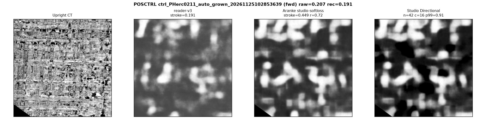
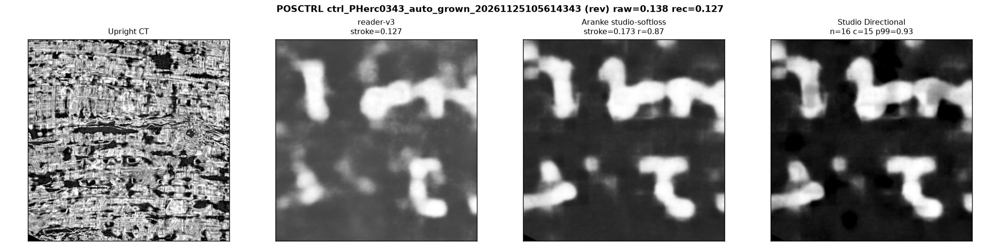

# Vesuvius Scroll Toolkit — 12-Scroll Open L0 Mesh Atlas, Headless Harvester & 3D Winding Tracer

Open-source MIT toolkit and verified `.tifxyz` surface dataset for the **[Vesuvius Challenge](https://scrollprize.org/)**:

1. **12-Scroll Open L0 `.tifxyz` Mesh Atlas (`v1.0.0` Release):** **350 unique, 3D-deduplicated L0 patches (`1,806.3 cm²` valid surface area)** across 12 virgin / lightly-covered eligible scrolls (`PHerc0257`, `0358`, `0826`, `0483A/B`, `0490A/B`, `1218`, `1545`, `0191`, `0175A/B`), ready to open in **VC3D** or re-score with next-generation ink models, plus a **2/2 visually verified positive control** on `PHerc0211` and `PHerc0343`.
2. **Headless VC3D L0 Harvester + Continuous Upright Renderer + CT-Peak Recto-Snapper:** Automated `vc_grow_seg_from_seed` harvesting with 3D `cKDTree` overlap deduplication, continuous Z-vertical resampling (`UprightTifXYZSurface`), and bounded local CT-peak slab recentering (`recenter_slab_ct_peak`, `+8.6%` stroke lift on `PHerc0211`'s spiral-fit mesh).
3. **Scroll Winding Tracer (`scroll_winding_tracer/`):** Zero-training, CPU-only 3D Z-slab winding-constraint generator achieving **99.08% precision (`540/545` exact, `0` undercounts) & 73.0% recall** on the 12-slab `PHercParis4` benchmark, with upstream-verified dual export for **VC3D** and `ScrollPrize/villa/spiral-fitting` (`WindingInferenceStore` v1).

---

## 1. 12-Scroll Virgin L0 `.tifxyz` Mesh Atlas (`v1.0.0` Release Assets)

Download any scroll's `.tifxyz` archive directly from the **[`v1.0.0` GitHub Release](../../releases/tag/v1.0.0)** (`57.3 MB` total across all 12 scrolls; each patch is standard VC3D `x.tif` / `y.tif` / `z.tif` / `meta.json`).

### End-to-End Harvester Positive Control (`2/2` Visually Confirmed Greek Letters)

To verify that patches grown automatically by our headless `vc_grow_seg_from_seed` + `UprightTifXYZSurface` pipeline stay close enough to the recto to recover real ink on both `113 keV` (`9.362 µm`) and `116 keV` (`8.640 µm`) protocols, we seeded 6 points near the known winning wraps of `PHerc0211` and `PHerc0343` (`scripts/harvester_positive_control.py`):

| Control Scroll | Scan Protocol | Auto-Grown Patches | Top `reader-v3` (raw / recentered) | Aranke `studio-softloss` | Visual Verification |
|---|---|---:|---:|---:|---|
| **`PHerc0211`** | `9.362 µm / 113 keV` | `5/5` above negative ceiling | **`0.2068`** / `0.1910` | `0.449` (`r = 0.72`) | Crisp Greek letters |
| **`PHerc0343`** | `8.640 µm / 116 keV` | `3/6` `>= 0.099` | **`0.1383`** / `0.1269` | `0.173–0.292` (`r = 0.84–0.87`) | Crisp two-line Greek letters |

| `PHerc0211` Auto-Grown Control (`0.207` raw) | `PHerc0343` Auto-Grown Control (`0.138` raw) |
|---|---|
|  |  |

### 12-Scroll Open Mesh Summary (`350` Unique Patches, `1,806.3 cm²` Valid)

All 350 patches were 3D-deduplicated (`cKDTree`, largest-first, `<65%` overlap within 25 vox) and screened zero-shot with `reader-v3` + Aranke `studio-softloss-20261023` (`10,120` evaluated 1024×1024 tiles; `0` readable letters found zero-shot — confirming that existing public weights hit a cross-scroll generalization wall and making this atlas an immediate re-screening benchmark for newly trained or self-trained ink models):

| Scroll | Scan Protocol | Unique L0 Patches | Valid Area (`cm²`) | Tiles Evaluated | Top Zero-Shot `reader-v3` | Visual Check of Top Hits |
|---|---|---:|---:|---:|---:|---|
| `PHerc0257` | `9.362 µm / 113 keV` | 28 | 158.3 | 892 | 0.059 | Blank |
| `PHerc0358` | `9.362 µm / 113 keV` | 29 | 164.0 | 917 | 0.066 | Blank |
| `PHerc0826` | `9.362 µm / 113 keV` | 30 | 169.6 | 932 | 0.139 | Delamination clouds (7 hits checked) |
| `PHerc1545` | `9.362 µm / 113 keV` | 28 | 158.3 | 849 | 0.043 | Blank |
| `PHerc0191` | `9.362 µm / 113 keV` | 29 | 164.0 | 827 | 0.111 | Intact papyrus weak/blobby spots (2 hits checked) |
| `PHerc0483A` | `8.640 µm / 116 keV` | 31 | 149.3 | 844 | 0.130 | Fracture blobs (9 hits checked) |
| `PHerc0483B` | `8.640 µm / 116 keV` | 30 | 144.5 | 817 | 0.072 | Blank / blob (1 hit checked) |
| `PHerc0490A` | `8.640 µm / 116 keV` | 30 | 144.5 | 834 | 0.056 | Blank |
| `PHerc0490B` | `8.640 µm / 116 keV` | 30 | 144.5 | 815 | 0.039 | Blank |
| `PHerc1218` | `8.640 µm / 116 keV` | 29 | 139.7 | 802 | 0.068 | Blank |
| `PHerc0175A` | `8.640 µm / 116 keV` | 28 | 134.8 | 785 | 0.167 | Mottled pitting / delamination (10 hits checked) |
| `PHerc0175B` | `8.640 µm / 116 keV` | 28 | 134.8 | 806 | 0.042 | Blank |
| **Total (12 Scrolls)** | **113 & 116 keV** | **350** | **1,806.3** | **10,120** | — | **0 readable letters zero-shot** |

*(In addition, `278/278` Nov 17 `PHerc0125` community meshes — `1,529.2 cm²` valid, `8,448` tiles — were swept with `--recenter-ct` and a 16-tile Aranke disagreement pilot: `0` readable letters.)*

---

## 2. Scroll Winding Tracer (`scroll_winding_tracer/`)

A lightweight, streaming, CPU-only Python package that generates high-precision **relative-winding** and **vertical same-winding** constraints for [Spiral Fitting](https://github.com/ScrollPrize/villa/tree/main/spiral-fitting) and **VC3D** directly from S3 OME-Zarr surface predictions + scroll umbilicus JSONs—with **zero neural training** and **zero full-volume downloads**.

### Full-Scroll Benchmark (`PHercParis4`, 12 Z-Slabs, `Z = 8,450..16,920`, 740 Human Pairs)

| Method | Precision (`Δw=1`) | Error Rate | Recall | Undercounts | Overcounts | Multi-Wrap `Δw≥2` Exact | Multi-Wrap `Δw≥5` Exact | Max Exact Span |
| --- | ---: | ---: | ---: | ---: | ---: | ---: | ---: | ---: |
| **Naive 2D Peak Counter** | 90.68% (`671/740`) | 9.32% | 90.7% | 63 | 6 | — | — | — |
| **Ours — `balanced` (`±14 px` 3D slab, default)** | **99.08% (`540/545`)** | **0.92%** | **73.0%** | **0** | 5 | **95.0%** (`95/100`) | **92.1%** (`35/38`) | **29 wraps** |
| **Ours — `strict` (`±24 px` wide delam guard)** | **98.90% (`359/363`)** | **1.10%** | 48.5% | **0** | 4 | **96.0%** (`72/75`) | **90.9%** (`20/22`) | 12 wraps |

- **Unbiased Unsupervised Spatial Cross-Check (`strict`):** **98.51%** (`66/67` exact) across **74.8%** average scroll coverage.
- **Zero-Training Cross-Scroll Generalization:** Tested on unseen flattened/folded scrolls including `PHerc0125` (`842` chains / `5,748` pts / `36`-wrap max chain in `13.4s` CPU) and `PHerc0800` (`8.64 µm`, `1,347` chains / `10,755` pts / `44`-wrap max chain in `13.6s` CPU).
- **100% Upstream-Verified Dual Export:** Emits both **VC3D `vc_pointcollections_json_version: 1`** (`relative_windings.json` + `same_windings.json`) and checksum-verified **`WindingInferenceStore` v1**, tested directly against `ScrollPrize/villa/spiral-fitting/winding_supervision.py` (`pytest` suite: 59 tests passing).

---

## 3. Quick Start

```bash
python -m venv .venv
# Windows: .\.venv\Scripts\activate   |   Linux/macOS: source .venv/bin/activate
pip install -e .

# 1. Generate VC3D + spiral-fitting winding constraints directly from AWS Open Data (CPU-only!)
scroll-winding-tracer --scroll PHerc0125 --z-slices 12768 --out outputs/pherc0125

# 2. Run unit & upstream compatibility tests (59 tests)
pytest

# 3. Run the headless L0 harvester on any scroll (requires VC3D AppImage / vc_grow_seg_from_seed)
python scripts/tranche2_vc3d_harvest.py --scrolls PHerc0191 --vc-bin /path/to/vc_grow_wrapper.sh --fast-reader-only --bf16

# 4. Run the harvester positive control on PHerc0211 & PHerc0343
python scripts/harvester_positive_control.py --scrolls PHerc0211 PHerc0343 --vc-bin /path/to/vc_grow_wrapper.sh --bf16
```

### Repository Structure

- [scroll_winding_tracer/](scroll_winding_tracer/) — Installable MIT Python package (`config.py`, `streaming.py`, `tracer.py`, `exporters.py`, `cli.py`)
- [scripts/tranche2_vc3d_harvest.py](scripts/tranche2_vc3d_harvest.py) — Headless `vc_grow_seg_from_seed` harvester + 3D `cKDTree` dedup + `.tifxyz` archival + full-mesh sweep
- [scripts/harvester_positive_control.py](scripts/harvester_positive_control.py) — End-to-end positive control verifying auto-grown L0 patches recover Greek letters on `PHerc0211` & `PHerc0343`
- [scripts/fl_radar_sweep.py](scripts/fl_radar_sweep.py) — Continuous `UprightTifXYZSurface`, strip-batched S3 chunk renderer, and `recenter_slab_ct_peak` CT-peak recto-snapper
- [scripts/stroke_scorer.py](scripts/stroke_scorer.py) & [scripts/aranke_runner.py](scripts/aranke_runner.py) — Thin-stroke DoG scorer & Aranke `studio-softloss` confirmation runner
- [tests/](tests/) — 59 unit & upstream compatibility tests (`pytest`)

## License

Code released under the **MIT License** ([LICENSE](LICENSE)). Underlying Herculaneum papyrus tomographic data from the Vesuvius Challenge Open Data repository are licensed under **CC BY-NC 4.0**.
